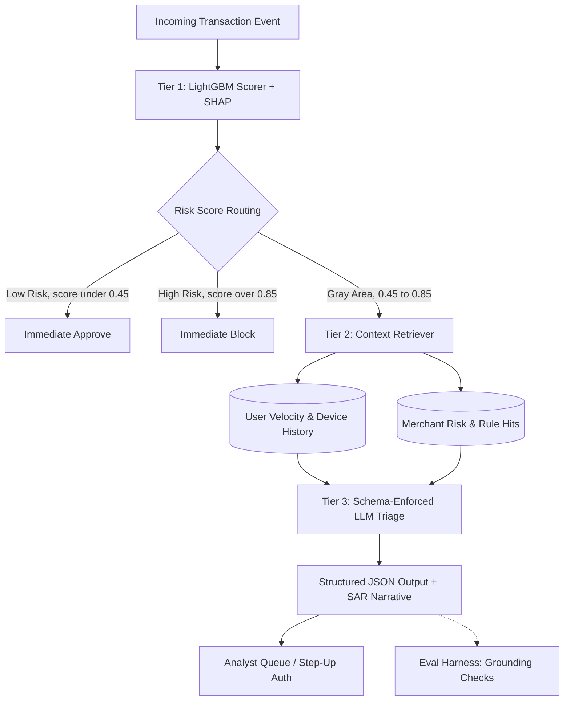

# Hybrid ML + LLM Fraud Triage Pipeline

A production-oriented reference architecture combining **sub-50ms tabular risk scoring (LightGBM + SHAP)** with **schema-enforced LLM reasoning** to automate gray-area transaction investigations and Suspicious Activity Report (SAR) drafting.

## Why Hybrid? (Architectural Trade-offs)
In real-time payment processing, authorization decisions must complete within strict latency SLAs (<100ms). Running an LLM directly on the hot path introduces unacceptable latency and cost overhead.

This architecture separates **real-time scoring** from **asynchronous investigation**:
1. **Tier 1 — Hot Path (<50ms):** A LightGBM classifier scores every transaction and computes local SHAP feature attributions. Clear approvals (`score < 0.45`) and high-confidence blocks (`score > 0.85`) resolve immediately.
2. **Tier 2 — Context Assembly:** Gray-area transactions (`0.45 <= score <= 0.85`) trigger a context retriever that aggregates user velocity, device telemetry, and merchant risk signals.
3. **Tier 3 — Structured LLM Triage:** An LLM constrained by strict Pydantic schemas synthesizes the ML attributions and behavioral history into an auditable SAR narrative, maps the event to known fraud typologies, and recommends an operational action (`APPROVE`, `STEP_UP_AUTH`, or `BLOCK`).

## System Architecture



Example Triage Output
Given a borderline transaction (risk_score: 0.68) flagged for unusual cross-border velocity and a new device fingerprint, the triage agent produces deterministic JSON:

```json
JSON
{
  "transaction_id": "tx_98412a",
  "recommended_action": "STEP_UP_AUTH",
  "confidence": 0.84,
  "primary_typology": "ACCOUNT_TAKEOVER",
  "cited_risk_factors": [
    "3x spike in 1-hour transaction velocity vs. 30-day baseline",
    "Unrecognized device fingerprint originating from new ASN",
    "High SHAP contribution (+0.29) from distance_from_home_km"
  ],
  "sar_narrative": "Cardholder initiated a $1,420.00 electronics purchase from an unrecognized device 1,850 km from their historical billing cluster, following two low-dollar authorization probes within 15 minutes. Pattern aligns with credential-stuffing Account Takeover (ATO). Recommend 3DS/OTP step-up challenge prior to settlement."
}
```

##Quickstart

Bash

### 1. Install dependencies
uv sync

### 2. Generate synthetic transaction logs & historical user baselines
uv sync --group dev
PYTHONPATH=. uv run python data/synthetic_generator.py --samples 5000 --fraud-rate 0.04

### 3. Run the grounding and latency evaluation suite
PYTHONPATH=. uv run pytest evals/

### 4. Run triage
PYTHONPATH=. uv run python -m src.run_triage


